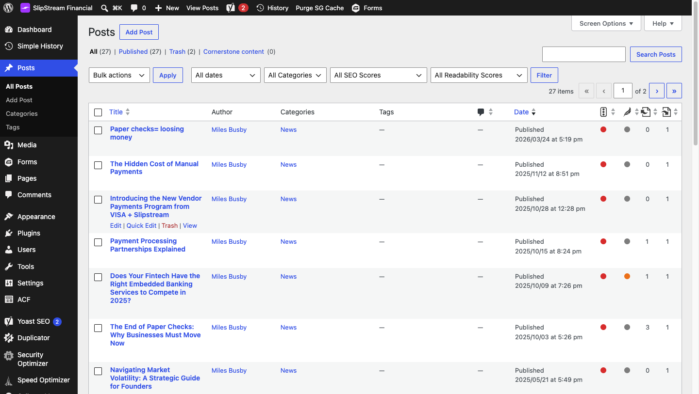
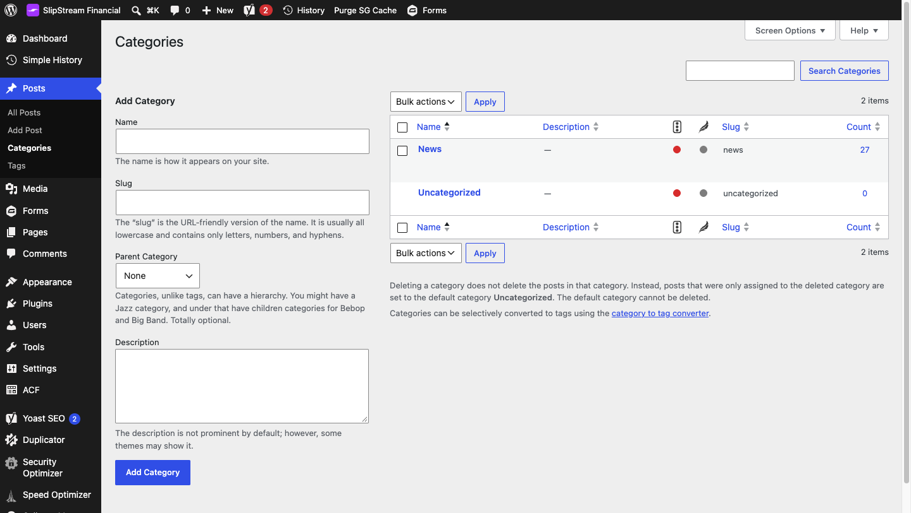
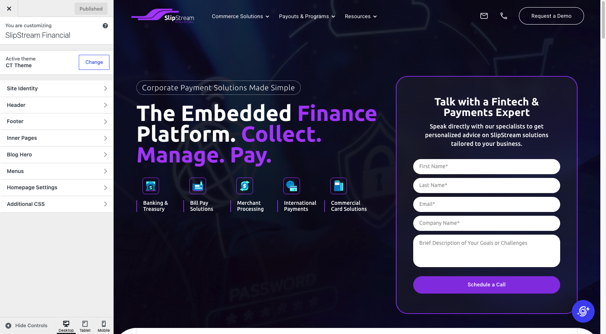

# Blog and resources

## Edit an article

Go to **Posts → All Posts** and select an article, or choose **Add New**. Maintain the title, body, categories, excerpt and featured image, then preview and save.

The theme renders the article header and content through its single-post template. A **Blog Inline CTA** block is available for a call to action inside an article, with a headline, CTA label, CTA URL and background image.

## Listings and categories

The posts page is selected under **Settings → Reading → Posts page**. In the local admin this is the published **Blog** page. The theme supplies the blog hero and listing layout (you do not edit those listing cards inside the page body).

Category archives use the same layout family, filtered to the category. Manage categories through **Posts → Categories** and assign them in each post’s settings. The local site’s active article category is **News**.

Listing behavior from the theme:

- About six posts per page on the blog index and archives
- Featured images appear on listing cards and in the single-post hero (theme fallbacks apply when an image is missing)
- Related articles on a post page are chosen by category

## Blog hero defaults

Open **Appearance → Customize → Blog Hero** to edit the label above the headline, headline, intro and optional background used on the posts index. Category archives use the category name and description instead of those Customizer copy fields. On the local site the label above the headline is set to **Knowledge Base**.

## Resources template

The **Resources** page template also renders the blog layout. Listing cards still come from WordPress posts. In the local admin the **Resources** page is trashed; confirm on production whether editors should use **Blog**, a restored Resources page, or both.

Developer follow-up: confirm production posts-page URL, category labels, sticky/featured behavior and removal of any remaining sample content.
