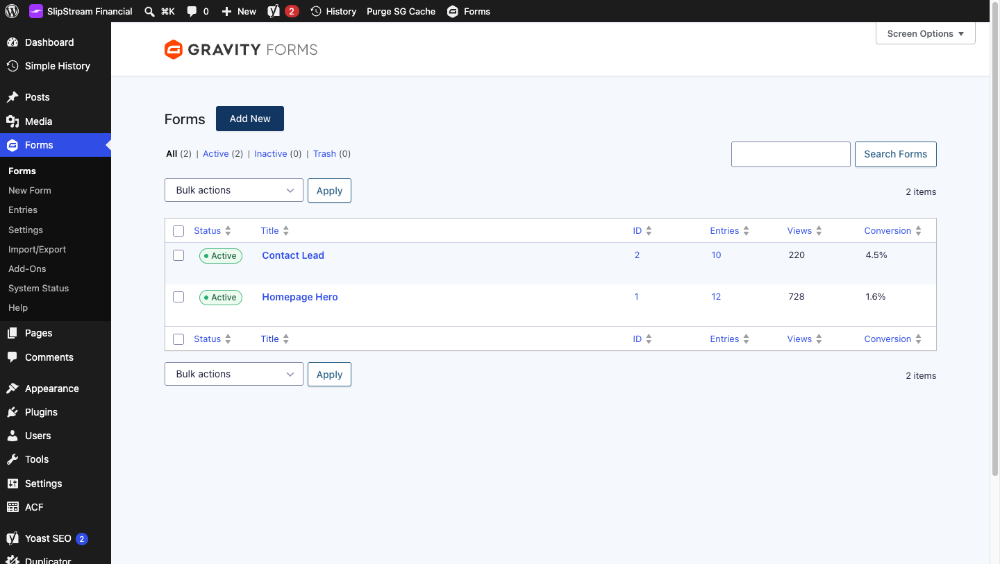
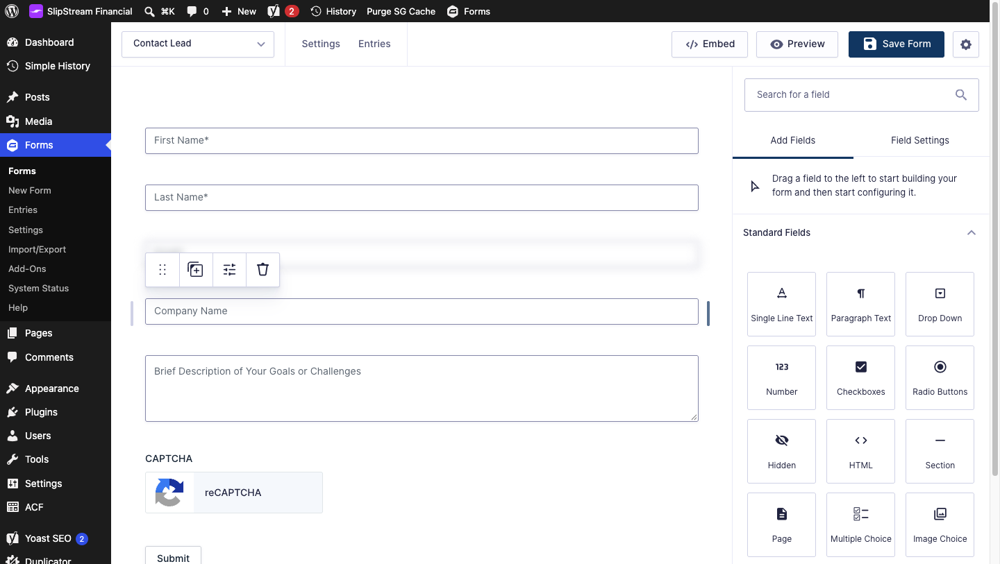
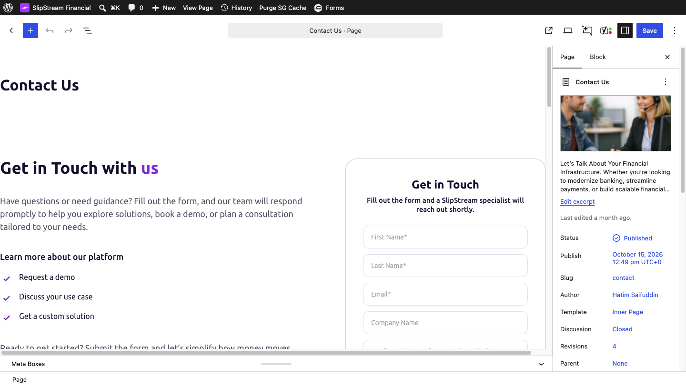

# Forms

The Homepage Hero and Contact Lead blocks integrate with **Gravity Forms**. Each has a **Gravity Form ID** field. The homepage hero also exposes an optional form-shortcode field; ask the developer to confirm its use before replacing an existing setup.

## Forms in use (local admin)

Verified in the local WordPress admin (November 19, 2026). Confirm the same IDs on production before relying on them there.

| Form ID | Form title | Typical placement |
| --- | --- | --- |
| 1 | Homepage Hero | Homepage Hero block (**Gravity Form ID**) |
| 2 | Contact Lead | Contact Lead blocks on contact / talk / demo pages |

Theme options mirror those IDs (`Homepage Hero` → 1, `Contact Lead` → 2).

### Field labels editors usually maintain

Both forms include First Name, Last Name, Email, Company Name and Message. The Contact Lead form also includes a CAPTCHA field. Edit labels, required flags and placeholder text inside Gravity Forms — not inside the page block.

Form title/subtitle text that appears above the inputs on the page still comes from the **Homepage Hero** or **Contact Lead** block fields.

## Basic maintenance

1. Open **Forms** in WordPress and identify the form used by the page.
2. Edit its fields in Gravity Forms. Review confirmations and notifications in the form settings.
3. Keep the page block’s Gravity Form ID matched to the intended form.
4. Save and test the form on the front end, including required-field errors and the confirmation message.

Form headings in the page block are separate from form input labels. If the form does not render, have the developer verify plugin activation and the selected form ID.

## Confirmations and notifications

Configure confirmation messages and notification routing inside each form’s Gravity Forms settings. Notification recipient addresses, API keys and spam-service credentials must stay in WordPress admin only — never commit them to this public documentation repo.

Developer follow-up: confirm production form IDs, notification delivery, integrations and spam protection after checking the live configuration.
