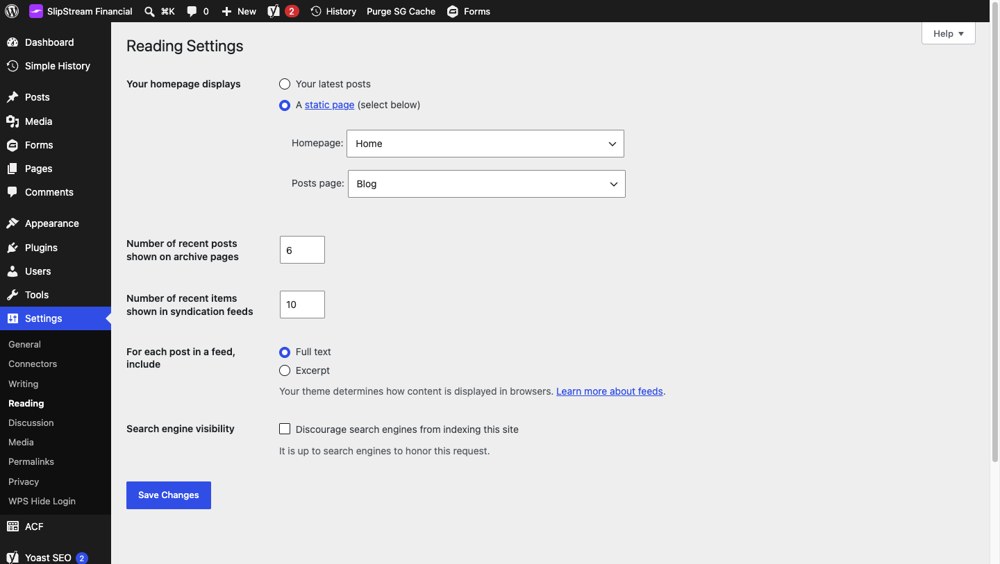
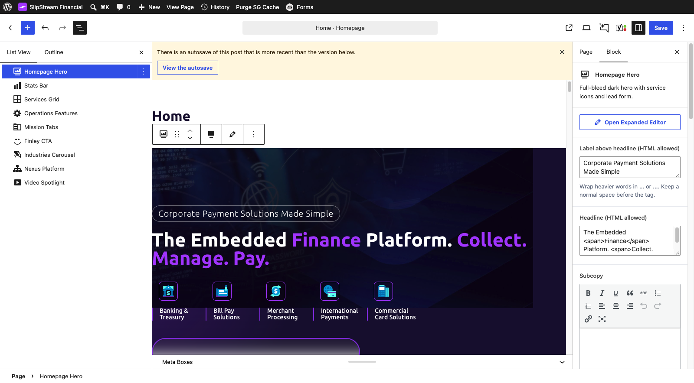

# Homepage

## Open the homepage

Check **Settings → Reading** to identify the page assigned as the homepage, then open it under **Pages**.

In the local admin this is the published page titled **Home**. The theme supports editable ACF homepage blocks. It also has a fallback layout rendered from theme defaults when homepage block content is absent. If the editor is empty but the front end shows sections, ask the developer to populate the editable blocks before making content changes.

## Section order

Keep this order unless a deliberate layout change is planned. Verified on the local **Home** page:

1. Homepage Hero
2. Stats Bar
3. Services Grid
4. Operations Features
5. Mission Tabs
6. Finley CTA
7. Industries Carousel
8. Nexus Platform
9. Video Spotlight

## Available homepage sections

| Section | Main content fields |
| --- | --- |
| Homepage Hero | Label above headline, headline, subcopy, background, form title/subtitle, Gravity Form ID, optional form shortcode, service cards (label, icon) |
| Stats Bar | Metrics (value, label) |
| Services Grid | Headline; cards (title, copy, CTA label/URL, image, wide card, panel position) |
| Operations Features | Headline, copy, columns; features (title, copy, icon) |
| Mission Tabs | Headline; tabs (tab label, panel title, copy, CTA label/URL, image); tags |
| Finley CTA | Headline, copy, dense layout, button label/URL, banner background, Finley image |
| Industries Carousel | Headline, copy; cards (title, URL, image) |
| Nexus Platform | Label above headline, headline, lead, body, image; checklist items |
| Video Spotlight | Label above headline, headline, copy, video file or URL, poster image |

## Editing a section

1. Open **Home** and use **List View** (Document Overview).
2. Select the existing block — do not insert a second copy of the same section.
3. Edit fields in the **Block** sidebar, or use **Open Expanded Editor** for longer fields and images.
4. For repeaters (cards, metrics, tabs, checklist rows), edit existing rows first; preview after adding, removing or reordering.
5. Preserve `` or `<strong>` tags inside headlines when they mark highlighted words.
6. Preview on desktop and mobile, then save/update the page.

Some empty fields still display theme fallback images or structure, so clearing a value may not remove every visual element from the page.

## Homepage form

The hero’s form title and subtitle belong to the **Homepage Hero** block. Form inputs, required rules, confirmations and notifications belong to [Gravity Forms](forms.md). On the local site the block’s **Gravity Form ID** points to form **1 — Homepage Hero**.
