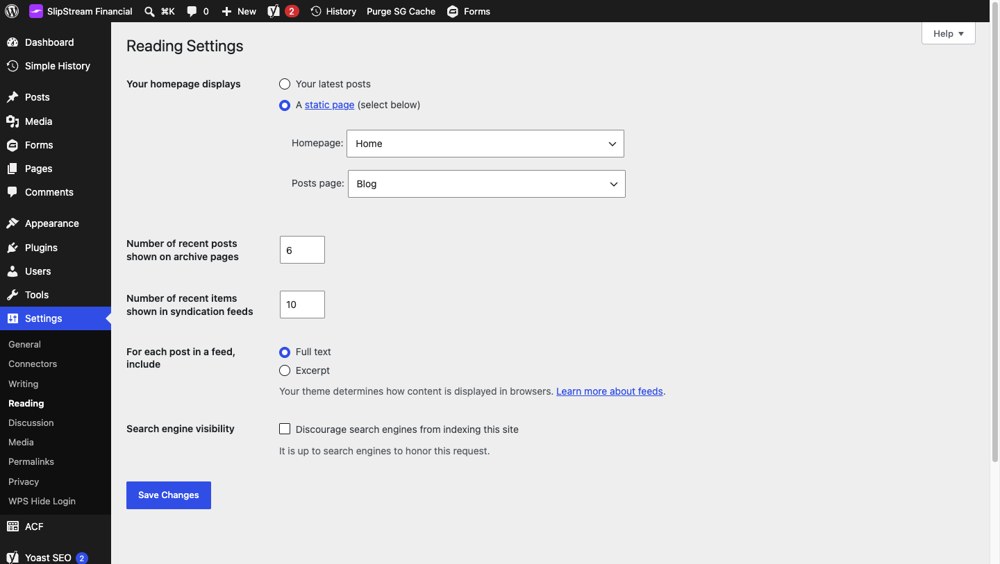

# Slipstream Financial documentation

A practical starting guide for maintaining the Slipstream Financial WordPress website.

## Where to make changes

| What you want to update | WordPress location |
| --- | --- |
| Homepage and page sections | Pages → select the page → Edit |
| Articles, categories and featured images | Posts |
| Images and uploaded files | Media → Library |
| Header, footer, blog hero defaults and inner-page hero | Appearance → Customize |
| Navigation links | Appearance → Menus |
| Lead form fields and messages | Forms (Gravity Forms) |

## Before you start

To request the website’s login URL or account access, contact your Coalition Technologies project team. Once you receive access, sign in using your assigned account. Available menus depend on your permissions.

This site uses a custom theme with ACF Pro blocks in the WordPress block editor. Select a section in **List View** to locate its fields. Preview your changes, check the page on desktop and mobile, then use **Update**, **Save** or **Publish**, as shown in your editor.

Start with [Editing pages](pages.md), [Homepage](home.md), or [Header, footer and menus](menu.md).

## Site map at a glance

Verified against the local WordPress admin (November 19, 2026):

| Area | How it is set up |
| --- | --- |
| Homepage | **Settings → Reading** → static front page **Home** |
| Blog listing | Posts page **Blog** (`/blog/`), layout from the theme |
| Solution / marketing pages | Mostly the **Inner Page** template + ACF blocks |
| Lead / contact pages | **Contact Lead** block + Gravity Forms |
| Header / footer chrome | **Appearance → Customize** (not page blocks) |

Production URLs and any staging-only pages still need a final check on the live site. See [Developer handoff](developers.md).

## About this guide

This base was checked against the local theme source on November 10, 2026, and extended from theme source plus the local WordPress admin on November 19, 2026. Screenshots were captured from the local admin with account menus and private fields obscured where needed. It covers implemented controls and templates. Production hosting, notification recipients and plugin licensing still need confirmation by the team. Do not store credentials, private email addresses or license keys in this public repository.
