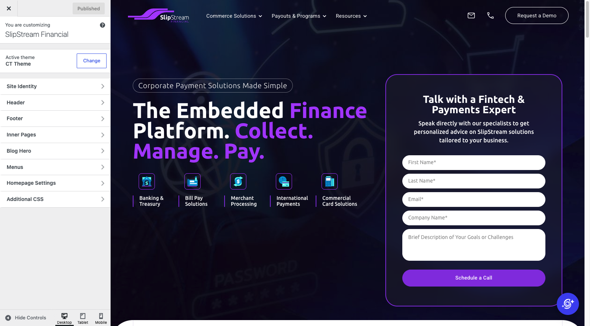
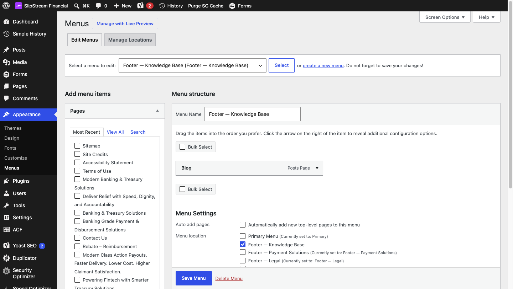

# Header, footer and menus

## Header

Open **Appearance → Customize → Header**. Available settings include:

- Logo and sticky header.
- Header CTA label and URL.
- Header email link.
- Phone display text and phone link.

Update the visible phone number and its `tel:` link together. The email link uses a `mailto:` address. Do not publish private addresses in this documentation repository; maintain them only in Customizer.

## Footer

Open **Appearance → Customize → Footer** to edit the about/blurb text, primary and secondary CTA labels/URLs, support email, sales email and copyright line. The theme also uses shared logo and phone settings.

On the local site the primary footer CTA points at the Request a Demo page and the secondary CTA at Talk to a Specialist. Preview the result and use **Publish** to save Customizer changes.

## Inner page and blog defaults

Also in **Appearance → Customize**:

| Section | What editors change |
| --- | --- |
| Inner Pages | Fallback hero background and compact hero minimum height |
| Blog Hero | Label above headline, headline, intro and optional background for the posts index |

## Navigation

Open **Appearance → Menus**, choose the menu and edit its links. Drag child items beneath their parent to create dropdown items, then save. Menu items may also have an optional **Menu icon** (Media Library image) used in mega-menu dropdowns.

The theme registers these menu locations. Local admin assignments:

| Location | Purpose | Local menu |
| --- | --- | --- |
| Primary Menu | Header navigation | Primary |
| Footer — Knowledge Base | Footer knowledge links | Footer — Knowledge Base |
| Footer — Payment Solutions | Footer solution links | Footer — Payment Solutions |
| Footer — Legal | Footer legal links | Footer — Legal |
| Footer Menu (legacy) | Compatibility location; confirm usage before assigning | Unassigned locally |

Check location assignments under **Manage Locations**. Header/footer buttons are controlled in the Customizer, separately from menu links.
