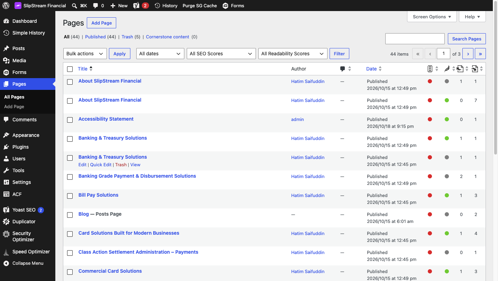
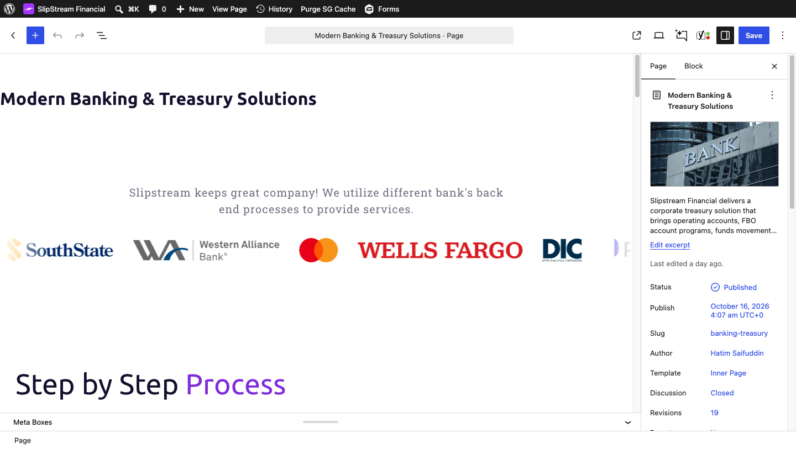
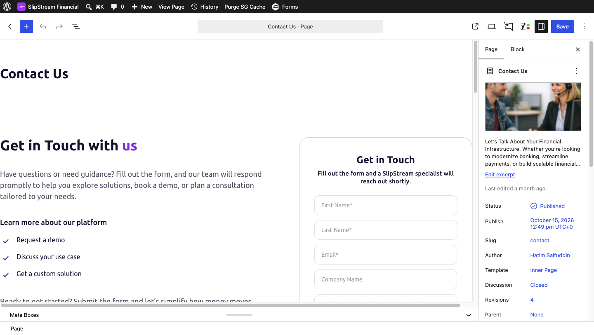
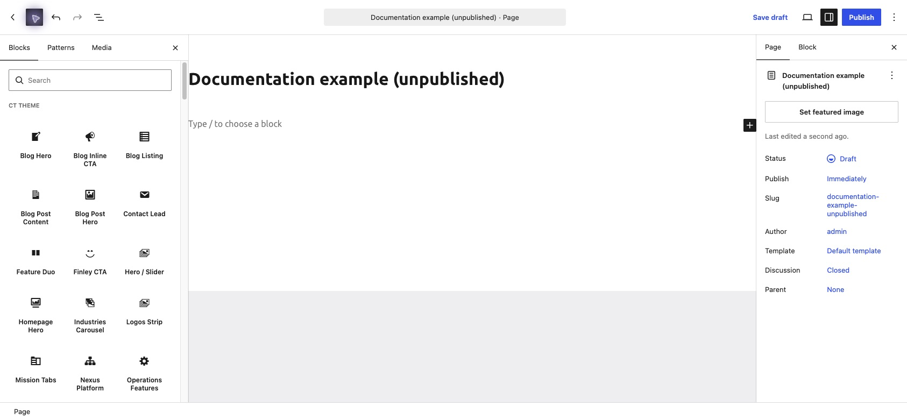
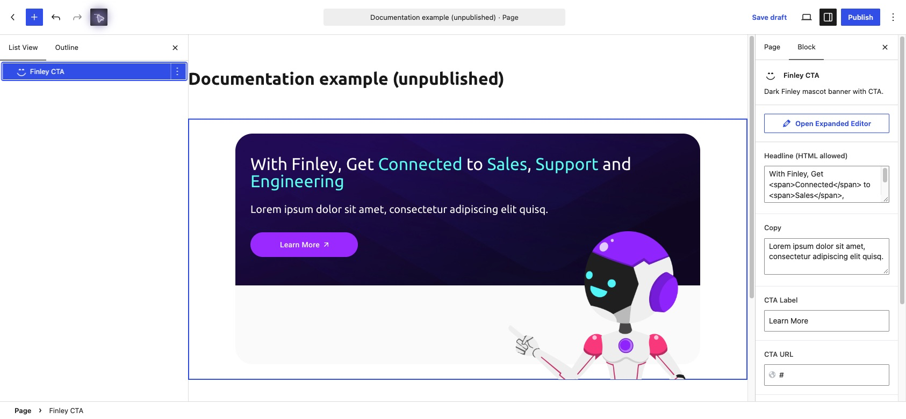
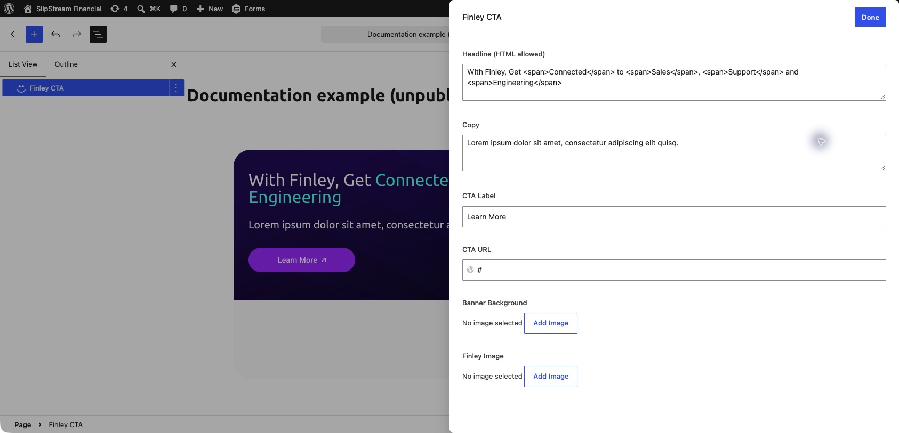

# Editing pages

1. Go to **Pages → All Pages** and open the page.
2. Open **List View** to locate the existing section.
3. Select the block and edit its ACF fields; switch to the block’s editing mode if it is showing a preview.
4. For lists such as cards, logos or steps, edit the existing repeater rows. Preview after adding, removing or reordering rows.
5. Preview links, images and spacing, then save the page.

## Templates

**Inner Page** adds a hero above the page content. It uses the page title, excerpt and featured image, with an **Inner Page Hero** field group for the label, headline override, button and background. The Customizer’s **Inner Pages** section supplies a fallback hero background and compact hero height.

Most solution, about, contact and lead pages in the local admin use **Inner Page**.

**Resources** renders the theme’s blog hero and post listing. Its layout is composed by the theme; editing the page body does not control that listing. The local **Resources** page is currently trashed — the public posts listing is the **Blog** page under **Settings → Reading**. Confirm whether a Resources page should be restored on production.

Avoid changing an existing page’s template without checking the preview.

## Solution page sections

The local **Modern Banking & Treasury Solutions** (`banking-treasury`) page uses the **Inner Page** template. Its hero is rendered by the template above the content blocks; it is not a Solution Hero block in List View. This was confirmed against the active theme and the local page’s saved template and block content on November 19, 2026.

### Edit the Banking & Treasury hero

1. Open the page under **Pages → All Pages** and keep its **Inner Page** template selected.
2. Edit the page **Title** for the default headline, or use **Inner Page Hero → Headline override**.
3. Edit the page **Excerpt** for the hero description.
4. In **Inner Page Hero**, edit **Label above headline**, **Button** and **Background** as needed. These are page-level fields, not a content block.
5. Change the page’s **Featured image** for the hero’s side image. The background falls back from the page’s **Background** field to its featured image, then the Customizer/theme default.
6. Preview and save the page.

Do not add a **Solution Hero** block to this page: the Inner Page template already renders its hero, so a separate hero block would create a second banner. The standalone Solution Hero block remains available for other layouts that require it.

### Content blocks below the hero

The saved Banking & Treasury page contains these blocks:

| Section | Main fields |
| --- | --- |
| Logos Strip | Headline, intro; logos (image, alt, URL); marquee toggle |
| Process Steps | Headline, copy; steps (tag, title, copy, image) |
| Video Copy Split | Headline, intro, body; checklist; poster; video file or URL; play label |
| Trust Image Cards | Headline, copy; cards (image, title, copy) |
| Platform Tags Split | Label above headline, headline, media, card title, tags, card copy |
| Feature Duo | Headline, copy; features (icon, title, copy); side image |
| Finley CTA | Same fields as on the homepage |

Local `banking-treasury` body stack (below the Inner Page hero): Logos Strip → Process Steps → Video Copy Split → Trust Image Cards → Platform Tags Split → Feature Duo → Finley CTA.

Other useful sections:

- **Team Grid** — headline, intro, members (photo, name, role, bio)
- **Contact Lead** — headline, intro, list intro, bullets, body, form title/subtitle, Gravity Form ID

Lead-style pages such as **Talk with a Fintech & Payments Expert** and **See SlipStream in Action** combine process/content blocks with **Contact Lead**. Prefer editing the existing **Contact Lead** block rather than adding another form block.

## Images and links

Choose images through the Media Library and provide useful alternative text for meaningful images. Check button labels and destinations together. Preserve existing headline formatting when editing fields labeled “HTML allowed”; it may control the highlighted words.

## Basic block editing: illustrated example

These screenshots show the local Slipstream WordPress admin using an unpublished demonstration page and the real **Finley CTA** block. Placeholder text is for demonstration only. They are not a published production page.

### 1. Choose a custom block

Use the **+ Block Inserter** in the top toolbar. Custom blocks appear under **CT Theme**; search by name or choose **Finley CTA**. On an existing page, select its existing block instead of adding a duplicate.

### 2. Select a block and find its fields

Open **Document Overview** in the toolbar, then **List View**. Select **Finley CTA**. The **Block** settings on the right show its headline, copy, CTA label and URL. If the sidebar is hidden, open **Settings**.

### 3. Use the expanded editor

Click **Open Expanded Editor** for a larger field panel. Edit the text and button destination; use **Add Image** for the banner or mascot. Preserve existing `` tags in the headline to retain highlighted words. Empty image fields can still display theme fallback artwork.

Click **Done** to return to the canvas. This closes the panel; it does not save the page. Use **Save draft** for an unpublished page, or the editor's save/update control for a published page. Preview before publishing.
