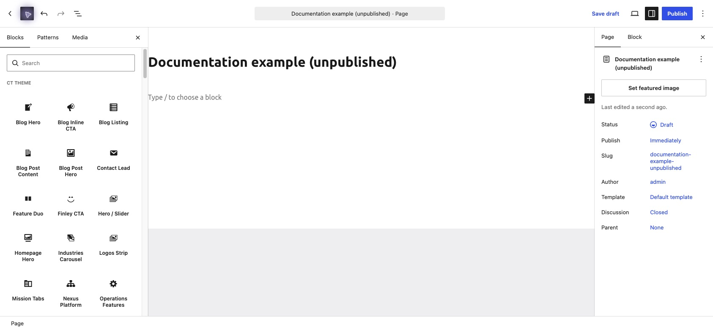
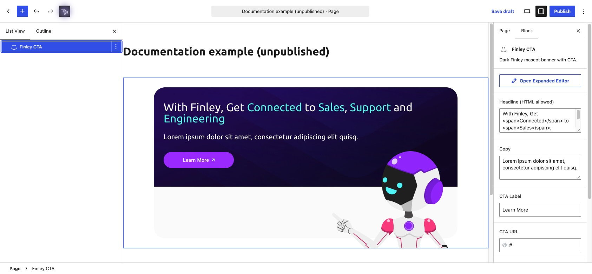
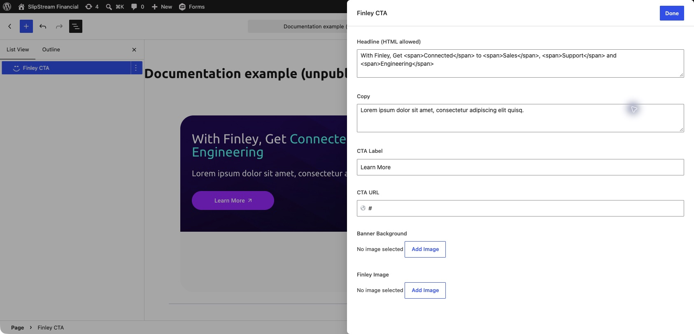

# Editing pages

1. Go to **Pages → All Pages** and open the page.
2. Open **List View** to locate the existing section.
3. Select the block and edit its ACF fields; switch to the block’s editing mode if it is showing a preview.
4. For lists such as cards, logos or steps, edit the existing repeater rows. Preview after adding, removing or reordering rows.
5. Preview links, images and spacing, then save the page.

## Templates

**Inner Page** adds a hero above the page content. It uses the page title, excerpt and featured image, with an **Inner Page Hero** field group for the label, headline override, button and background. The Customizer’s **Inner Pages** section supplies a fallback hero background and compact hero height.

**Resources** renders the theme’s blog hero and post listing. Its layout is composed by the theme; editing the page body does not control that listing.

Avoid changing an existing page’s template without checking the preview.

## Solution page sections

The theme includes Solution Hero, Logos Strip, Process Steps, Video Copy Split, Trust Image Cards, Platform Tags Split, Feature Duo and Finley CTA blocks. These are the section family documented for Banking & Treasury in the theme source. Actual page placement should be confirmed in the editor.

Other available sections include **Team Grid** (headline, intro and members) and **Contact Lead** (copy, bullets, form heading and Gravity Form ID).

## Images and links

Choose images through the Media Library and provide useful alternative text for meaningful images. Check button labels and destinations together. Preserve existing headline formatting when editing fields labeled “HTML allowed”; it may control the highlighted words.

## Basic block editing: illustrated example

These screenshots show the local Slipstream WordPress admin using an unpublished demonstration page and the real **Finley CTA** block. Placeholder text is for demonstration only.

### 1. Choose a custom block

Use the **+ Block Inserter** in the top toolbar. Custom blocks appear under **CT Theme**; search by name or choose **Finley CTA**. On an existing page, select its existing block instead of adding a duplicate.

### 2. Select a block and find its fields

Open **Document Overview** in the toolbar, then **List View**. Select **Finley CTA**. The **Block** settings on the right show its headline, copy, CTA label and URL. If the sidebar is hidden, open **Settings**.

### 3. Use the expanded editor

Click **Open Expanded Editor** for a larger field panel. Edit the text and button destination; use **Add Image** for the banner or mascot. Preserve existing `` tags in the headline to retain highlighted words. Empty image fields can still display theme fallback artwork.

Click **Done** to return to the canvas. This closes the panel; it does not save the page. Use **Save draft** for an unpublished page, or the editor's save/update control for a published page. Preview before publishing.
